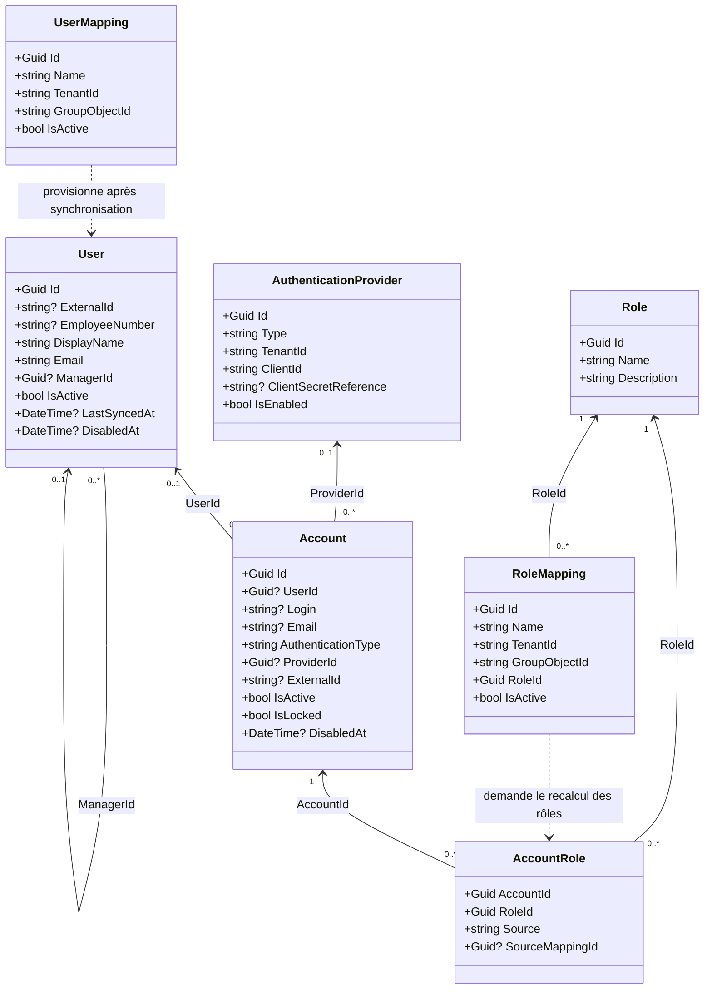
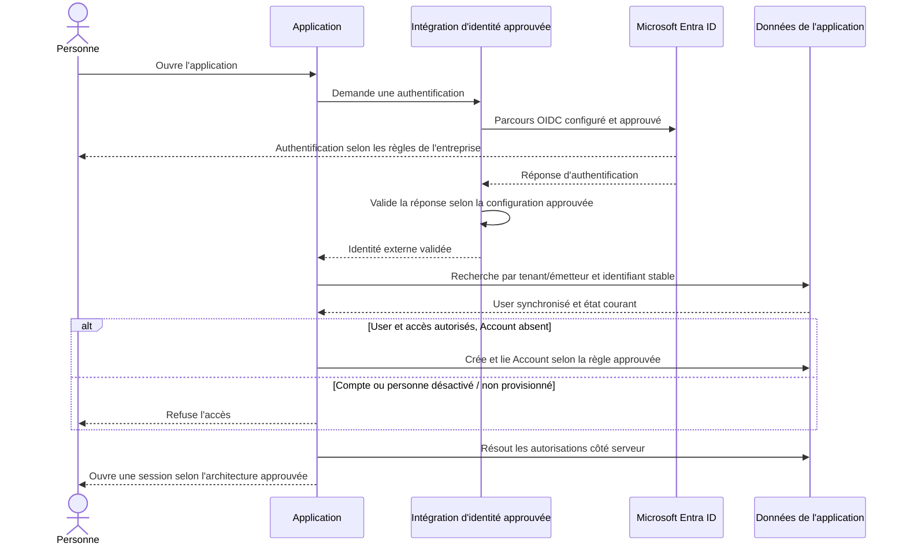

# Comptes, utilisateurs, rôles et Microsoft Entra ID

Microsoft Entra ID est le nom actuel d'Azure Active Directory (Azure AD). Dans ce guide, « annuaire » désigne le tenant d'entreprise approuvé.

## 1. Deux concepts métier distincts

### Account : identité d'accès

`Account` représente une identité qui peut s'authentifier auprès de l'application. Elle porte son état d'accès et, si la conception approuvée le prévoit, les attributions utilisées par l'autorisation. Elle n'est pas la personne métier à laquelle les projets, tâches ou historiques sont associés.

Champs de référence à adapter au besoin métier et aux règles de données du projet :

| Champ | Rôle proposé | Point d'attention |
| --- | --- | --- |
| `Id` | Identifiant interne du compte | Généré par l'application ; ne pas le confondre avec l'identifiant Entra. |
| `UserId` | Lien facultatif vers `User` | Un compte est lié à zéro ou une personne ; une personne peut avoir plusieurs comptes. |
| `Login`, `Email` | Informations d'affichage ou de recherche | Ne pas les utiliser comme clé d'identité durable : ils peuvent changer ou être réattribués. |
| `AuthenticationType` | Type d'identité configuré | SSO d'entreprise est le mode standard ; le mode local est réservé à l'unique compte administrateur de l'application. |
| `ProviderId` | Référence au fournisseur approuvé | Facultatif selon le modèle d'identité retenu. |
| `ExternalId` | Identifiant externe stable | Rapproché avec le tenant et l'émetteur ; ne jamais faire le rapprochement sur l'e-mail seul. |
| `IsActive`, `IsLocked`, `DisabledAt` | État d'accès | Les règles de transition et de révocation doivent être définies. |
| `FailedLoginAttempts`, `LockedUntil`, `PasswordChangedAt` | Données de gestion d'un mot de passe local | Sans objet pour un compte SSO si l'application ne gère pas son mot de passe. |
| `LastLoginAt`, `CreatedAt`, `UpdatedAt` | Dates d'audit | Fixer les règles de précision, fuseau et conservation. |

Le hash d'un mot de passe ne concerne que l'unique compte administrateur local de l'application et doit être géré selon les mécanismes de sécurité approuvés. Aucun autre compte local ne doit être créé. Le SSO reste l'authentification de tous les autres comptes.

### User : personne métier

`User` représente la personne référencée par les données métier, quel que soit son moyen de connexion. Les objets métier (par exemple une demande, un projet ou une tâche) devraient référencer cette identité métier plutôt qu'un compte technique de connexion.

Champs de référence, à réduire au strict besoin métier :

| Champ | Rôle proposé | Point d'attention |
| --- | --- | --- |
| `Id` | Identifiant interne de la personne métier | Utilisé par les relations métier. |
| `ExternalId` | Référence d'annuaire éventuelle | Définir tenant, émetteur et source de vérité ; éviter un second identifiant redondant sur `Account` sans justification. |
| `EmployeeNumber` | Identifiant RH éventuel | Donnée potentiellement sensible ; ne l'importer que si nécessaire et autorisé. |
| `FirstName`, `LastName`, `DisplayName`, `Email` | Informations de profil | N'importer que les attributs approuvés et nécessaires à l'application. |
| `PhoneNumber`, `JobTitle`, `Department`, `Company` | Attributs facultatifs | Confirmer l'usage, la classification et la durée de conservation avant synchronisation. |
| `ManagerId` | Lien hiérarchique facultatif vers un autre `User` | À utiliser uniquement si le besoin métier le requiert. |
| `IsActive`, `DisabledAt` | État métier de la personne | Une désactivation ne supprime pas ses données ni son historique. |
| `LastSyncedAt`, `CreatedAt`, `UpdatedAt` | Suivi des mises à jour | Distinguer une synchronisation réussie d'une tentative échouée. |

`Account.IsActive` et `User.IsActive` ne décrivent pas la même chose. L'accès exige un compte autorisé et, lorsque celui-ci est lié à une personne, une personne autorisée.

## 2. Fournisseur, rôles et mappings

Les structures ci-dessous constituent le modèle conceptuel de référence. Chaque application peut adapter son schéma physique sans changer les responsabilités des entités ni les règles d'accès.

- `AuthenticationProvider` décrit un fournisseur d'identité approuvé : type, tenant/émetteur, identifiant client, paramètres de découverte et état d'activation. Un secret ou une clé privée n'est jamais stocké en clair dans la base. Une référence vers un coffre approuvé ne suffit pas à autoriser une configuration modifiable depuis l'application.
- `Role` représente un ensemble nommé d'autorisations. Le socle standard prévoit Administrateur, Utilisateur et Visiteur ; les permissions précises de chaque rôle dépendent des fonctionnalités de l'application.
- `AccountRole` associe un compte à un rôle : les autorisations sont rattachées à l'identité d'accès, indépendamment du profil métier `User`.
- `UserMapping` associe un groupe d'annuaire approuvé au périmètre des personnes à provisionner.
- `RoleMapping` associe un groupe d'annuaire approuvé à un rôle applicatif.

Pour un groupe ou une identité externe, conserver et comparer des identifiants immuables approuvés, contextualisés par tenant/émetteur. Le nom affiché d'un groupe peut changer et n'est pas une clé fiable. Les identifiants réels de tenant, d'application, de groupes et d'utilisateurs ne doivent pas apparaître dans les exemples du template.

Une synchronisation doit pouvoir distinguer les attributions issues d'un mapping de celles provenant d'une autre source autorisée. Sinon, le retrait d'un groupe risque d'effacer à tort un rôle accordé séparément. La propriété des rôles et la priorité en cas de mappings multiples sont des décisions ouvertes.

### Diagramme de classes de référence

Les associations illustrent le modèle de référence : un compte peut être lié à zéro ou un `User`, un `User` peut avoir plusieurs comptes, et les rôles sont attribués aux comptes.

## 3. Authentification et configuration

Le standard utilise le SSO d'entreprise via Microsoft Entra ID et OIDC. La plateforme crée les clients et paramètres standards d'application par un parcours automatisé préapprouvé ; aucun ticket IT n'est requis pour un projet conforme au scaffold. Les contrôles d'autorisation restent dans la couche serveur de confiance ; masquer une page ou un bouton ne protège pas une API.

### Compte administrateur local

Chaque application dispose d'un unique compte administrateur local pour l'administration et le secours. Il est géré séparément du SSO, exclu de la synchronisation Entra et protégé selon les règles de sécurité approuvées. Aucun autre compte local n'est permis. Sa création et son stockage suivent le processus automatisé approuvé ; la récupération est réservée au processus de support autorisé. Ne jamais mettre le mot de passe ou son hash dans le dépôt.

### Fournisseur dynamique

La configuration des fournisseurs est administrable depuis une page dédiée et peut être appliquée sans nouvelle livraison. Son accès est réservé aux administrateurs autorisés. Toute modification est validée, auditée et réversible selon les contrôles de l'application ; les identifiants de fournisseur et secrets restent gérés par l'IT.

Les valeurs sensibles (secret client, clé privée ou certificat) restent dans le mécanisme de secrets approuvé. La base et l'interface ne stockent ou n'affichent que la référence protégée. Tenant, client, émetteur et URL sont injectés par le provisionnement automatisé depuis le profil approuvé ; ne pas accepter une URL d'autorité arbitraire depuis l'interface d'administration.

### Permissions d'annuaire

La synchronisation standard utilise les groupes et attributs Entra autorisés pour l'application. La plateforme provisionne l'identité technique et les permissions minimales depuis le profil approuvé ; l'IT conserve la propriété centrale de l'App Registration et du mécanisme de provisionnement. Ne jamais utiliser un compte personnel comme identité de synchronisation. Aucune permission, valeur de tenant ou donnée réelle n'est inscrite dans le template.

## 4. Première connexion SSO : scénario illustratif

Le diagramme montre uniquement l'enchaînement conceptuel pour une personne déjà provisionnée par une synchronisation réussie. Il ne prescrit ni bibliothèque, ni type de jeton, ni stockage de session. La validation OIDC doit être confiée à l'intégration approuvée ; l'API ne fait jamais confiance à des claims non validés par celle-ci.

Au premier login SSO réussi, l'application crée le `Account` et le lie au `User` déjà synchronisé, à partir de l'identifiant externe stable. Une identité absente du périmètre provisionné est refusée. Ne jamais associer un compte à un `User` sur la seule égalité d'adresse e-mail.

## 5. Synchronisation : déroulement standard

1. Une exécution identifiée commence et lit uniquement les groupes/attributs autorisés pour l'application, avec l'identité technique provisionnée par l'IT.
2. Le connecteur récupère toutes les pages de résultats et signale tout échec, quota, résultat tronqué ou groupe inaccessible. Une lecture partielle n'est pas un instantané complet.
3. Après confirmation d'un instantané complet, la synchronisation rapproche les personnes avec une clé externe stable, crée les `User` manquants et met à jour uniquement les attributs autorisés.
4. Au premier login SSO d'un utilisateur actif déjà synchronisé, l'application crée le `Account` et le lie au `User` correspondant.
5. Les appartenances actuelles recalculent les rôles issus des mappings actifs. Les attributions obsolètes issues de ces mappings sont retirées ; les autres sources ne sont pas modifiées.
6. Une personne qui sort de tous les groupes configurés pour le provisionnement est désactivée après un instantané complet. Ses comptes perdent l'accès, mais ses objets métier, son historique et ses relations sont conservés.
7. Une personne désactivée qui réintègre un groupe de provisionnement est réactivée après synchronisation complète ; ses rôles sont recalculés depuis les appartenances courantes.
8. L'exécution et les changements de statut/droits sont audités sans journaliser de secret, jeton ou profil complet inutile. Les relances doivent être idempotentes.

Ne jamais désactiver des utilisateurs parce qu'une requête a échoué, qu'une page n'a pas été lue ou que l'annuaire est indisponible. Marquer l'exécution comme échouée et alerter l'équipe responsable. L'application applique la limite de fraîcheur configurée par l'IT ; aucune exécution partielle ne peut entraîner une désactivation massive.

## 6. Exemple fictif de réconciliation

Les noms `G-APP-USERS`, `G-APP-ADMINS`, `G-APP-OPERATORS` et `G-APP-VISITORS` ci-dessous sont fictifs. Chaque application sélectionne ses groupes parmi les choix autorisés par le parcours standard ; aucune permission technique n'est demandée au Citizen.

| Personne fictive | État avant l'exécution complète | Changement observé | Résultat standard |
| --- | --- | --- | --- |
| Alex | Membre de `G-APP-USERS` et `G-APP-ADMINS` | Aucun | `User` actif ; rôle Administrateur calculé depuis le groupe approuvé. |
| Camille | Membre de `G-APP-USERS` et `G-APP-OPERATORS` | Quitte `G-APP-OPERATORS`, reste dans `G-APP-USERS` | Retirer seulement l'attribution Utilisateur issue de ce mapping ; conserver `User` et compte actifs si une règle d'accès approuvée le permet. |
| Morgan | Membre de `G-APP-USERS` et `G-APP-VISITORS` | Quitte tous les groupes de provisionnement | Après un instantané complet seulement, désactiver le `User` et ses comptes associés ; garder ses données métier. |
| Morgan | Désactivé après la synchronisation précédente | Réintègre `G-APP-USERS` | Après un instantané complet et selon la règle approuvée, réactiver et recalculer les rôles ; conserver l'historique. |
| Toute personne | Dernier état réussi connu | L'annuaire est indisponible ou les résultats sont incomplets | Ne pas effectuer de désactivation de masse ni traiter le résultat comme un retrait de groupe ; signaler l'échec et appliquer la politique de fraîcheur décidée. |

Si une personne autorisée à se connecter n'a aucun rôle issu d'un `RoleMapping`, elle reçoit le rôle Visiteur par défaut. Ce rôle n'accorde que les permissions de consultation explicitement définies pour l'application. Un compte ou un `User` désactivé n'obtient aucun accès, quel que soit son rôle.

## 7. Désactivation, sessions et audit

Désactiver un `User` ne supprime pas ses données métier. Les comptes associés perdent l'accès, y compris avec une session ou un jeton déjà émis. Les API vérifient l'état effectif dans la couche serveur de confiance ; le mécanisme de révocation ou d'invalidation respecte l'architecture de session approuvée.

Conserver un historique contrôlé des changements de rôles, désactivations, réactivations et synchronisations : horodatage, résultat de l'exécution, règle/mapping à l'origine et identité technique ou opérateur selon le cas. Limiter les données personnelles consignées et ne jamais journaliser secrets, jetons ou réponses complètes de l'annuaire.

## 8. Paramètres standards par application

- Tenant, App Registration, URI de redirection et permissions minimales injectés par le provisionnement automatisé.
- Groupes de provisionnement et de rôles sélectionnés dans le périmètre autorisé, avec règles standard de synchronisation.
- Attributs importés, source de vérité, classification et conservation définis par les profils approuvés.
- Permissions précises associées aux trois rôles et aux fonctionnalités, limitées au catalogue autorisé.
- Limite de fraîcheur des données et alertes selon la configuration standard de la plateforme.
- Références de secrets, administration des fournisseurs et récupération du compte administrateur gérées selon les contrôles de la plateforme.
- Audit et support assurés par les services partagés de la plateforme.

Le modèle d'identité et d'accès décrit dans ce guide est le standard cible du kit. Les automatisations nécessaires ne sont pas encore présentes dans ce dépôt ; les noms fictifs de l'exemple ne constituent pas une configuration opérationnelle.
